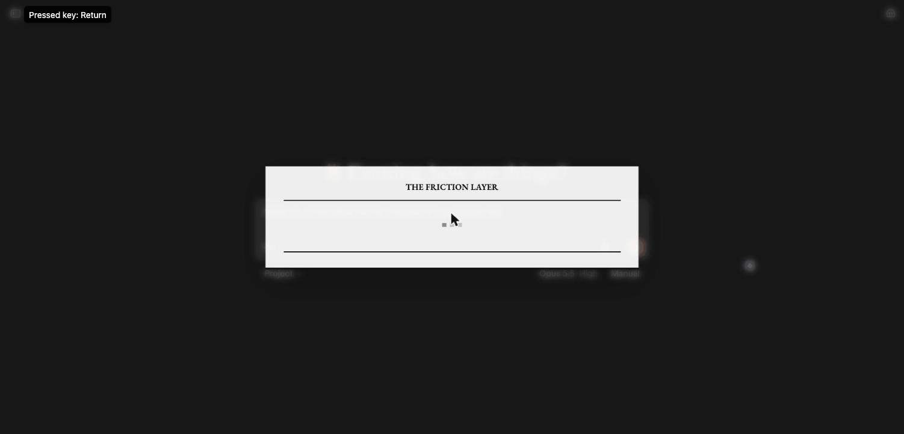
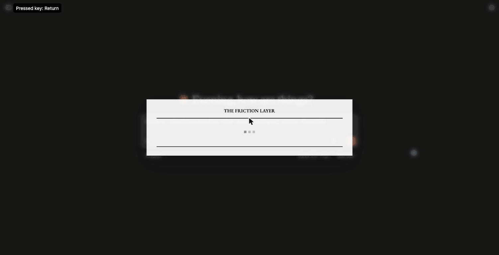
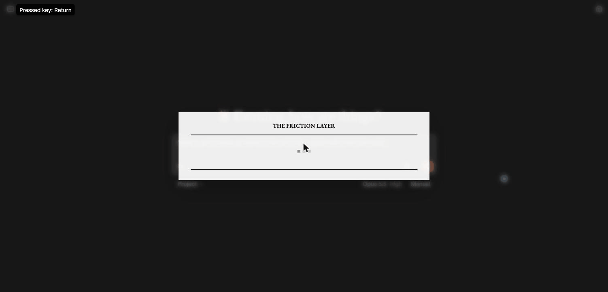
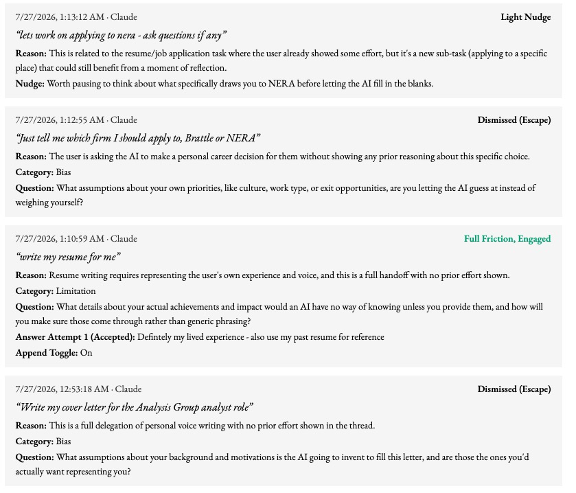
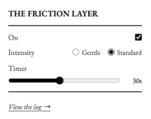

# The Friction Layer

A personal Chrome extension, built for one user. It watches for the moment you
ask an AI tool to do a piece of thinking that should be yours, and right then
it asks you one question before your message goes through. The rest of the time
it stays silent.

Works on **claude.ai** and **chatgpt.com**, and nowhere else, by design.

There is no hosted version. An extension only runs where it is loaded, so the
way to try it is to load this folder into Chrome (steps below).

---

## What it does

Every message of three words or more is read by a classifier before it sends.
It lands in one of three layers.

### 1. Full friction

When you hand off judgment work (a cover letter, an essay, a decision), the
message is held. One question appears, a 30 second timer runs, and you write a
sentence of your own thinking. The message then goes through with your answer
attached at the top, so the AI starts from your thinking instead of a blank
page.



### 2. The effort check

Your answer is read by a second, smaller model. Filler such as "idk" or a
restated prompt gets turned back once with a nudge to try again. A real answer
goes through. Two rejections in a row also go through, so the cost is capped
at one retry.



### 3. The nudge

Quick, lower stakes asks (a follow up email, a short bio) do not need a full
stop. A small black and white chip appears with one prompt to think about, and
the message sends right away.



Mechanical asks (fix the grammar, translate this, convert a CSV) pass with only
a brief loading card. Messages under three words skip the check entirely.

*The messages and answers shown in the three recordings above are fictional
examples written for the demo. They do not describe real people, employers, or
events.*

### The log

Every decision is written to local storage, including the ones where nothing
visible happened. Each entry records the time, the site, the message, which
layer it landed in, the classifier's reason and category, the question that was
asked, the answer that was typed, and whether the card was engaged with or
dismissed with Escape.



Unlike the three recordings above, this is a sample of real personal usage, not
a staged demo. Dismissals are recorded the same way as engagements, so the log
shows how often the friction is actually sat through rather than skipped. Two
of the four entries here were dismissed with Escape. That number is the point of
keeping the log.

---

## Does the classifier get it right

**28 of 28** on the labeled eval set, run November 8, 2026 with
`claude-sonnet-5` at low effort.

`eval/cases.json` holds 28 messages and the outcome each one should get.

- 8 full handoffs of judgment work (cover letters, a research writeup, a
  decision the user wants made for them)
- 6 quick, ambiguous asks that should draw a nudge
- 10 mechanical asks that should pass silently
- 4 thread context cases (prior effort shown, a check on the user's own draft,
  a friction question answered moments ago)

Where two outcomes are both defensible, the case accepts either. This is one
run on a small set written by the same person who wrote the prompt, so read it
as a sanity check, not a benchmark.

```bash
node eval/run.js --dry-run   # list the cases, no API calls
node eval/run.js             # run the shipped classifier on every case
```

The runner loads `background.js` unmodified, so it tests the exact prompt and
parsing the extension ships with. It prints one line per case and a final
score. It reads the key from `config.js`, or from `ANTHROPIC_API_KEY` if that
is set. One run is 28 Sonnet calls at low effort. The last result is saved to
`eval/last-run.json`, which is not committed.

---

## How to load it

1. Open Chrome and go to `chrome://extensions`.
2. Turn on **Developer mode** (top right corner).
3. Click **Load unpacked** and pick this folder (`friction-layer`).
4. Pin it from the puzzle piece icon if you want quick access to settings.

After changing any file here, including `config.js`, click the **reload** icon
on the extension's card in `chrome://extensions`.

## Adding your Anthropic API key

Copy the template, then paste your key between the quotes in `config.js`.

```bash
cp config.example.js config.js
```

```js
const FRICTION_CONFIG = {
  apiKey: "sk-ant-...",   // paste here
  classifyModel: "claude-sonnet-5",
  classifyEffort: "low",
  judgeModel: "claude-haiku-4-5",
  judgeEffort: null,
};
```

The key stays in this folder on your machine. Only the extension's background
worker reads it, and it is only ever sent to `api.anthropic.com`. `config.js`
is in `.gitignore`, so it never gets committed. `config.example.js` is the only
tracked version.

There are two calls and two models, and neither is Opus.

- **The classifier** runs on **Sonnet**. It reads the task type, whether you
  are handing it off, and any effort already in the thread, then writes the
  question. This is the harder call.
- **The effort check** runs on **Haiku**. It makes a narrow yes or no call on
  one sentence, so the cheaper, faster model is enough. Haiku 4.5 does not
  accept the `effort` parameter, so `judgeEffort` has to stay `null`.

## Trying it yourself

Both sites match the selectors in `content.js` as of November 2026. These five
messages cover every path.

| Type this | What should happen |
|---|---|
| `thanks` | Sends instantly. Too short to check, logged as a skip. |
| `Fix the grammar in this paragraph` | Brief loading card, then sends. No friction. |
| `Write my cover letter for the Analysis Group analyst role` | Full card with a question, timer, and answer box. |
| `Write a quick follow up email to this recruiter` | Nudge chip appears and the message sends right away. |
| Press **Escape** on a full card | Card fades, message sends, dismissal is logged. |

## Settings

Click the toolbar icon.



- **On or off**
- **Intensity.** `standard` (the default) fires every time. `gentle` fires only
  in the first ten minutes on a site, and the session resets after 30 minutes
  away.
- **Timer.** 5 to 60 seconds, 30 by default.
- **View the log.** Opens a private local page with every entry and a weekly
  chart.

Everything is stored in local browser storage. Nothing leaves your machine
except the calls to the Anthropic API.

---

## Research behind it

- **The timed pause** comes from Buçinca, Malaya, and Gajos (2021),
  *To Trust or to Think: Cognitive Forcing Functions Can Reduce Overreliance on
  AI in AI-assisted Decision-making*, ACM CSCW1
  ([arXiv 2102.09692](https://arxiv.org/abs/2102.09692)), the paper that
  introduced cognitive forcing functions. In their "wait" condition the AI
  appeared to process for exactly 30 seconds before showing its suggestion,
  and that reduced overreliance. That is why the default timer is 30 seconds.
- **The question types** (risk, bias, limitation, alternative) come from Cai,
  Arawjo, Sarkar, and collaborators, *"It makes you think": Provocations Help
  Restore Critical Thinking to AI-Assisted Knowledge Work*
  ([arXiv 2501.17247](https://arxiv.org/abs/2501.17247)). Their provocations
  worked by pointing out risks, biases, limitations, or alternatives.
- **Why it matters** comes from Liu, Christian, Dumbalska, Bakker, and Dubey
  (2026) ([arXiv 2604.04721](https://arxiv.org/abs/2604.04721)), a randomized
  controlled trial showing AI assistance lowers persistence and independent
  performance within about ten to fifteen minutes.

## What lives where

| File | Role |
|---|---|
| `manifest.json` | MV3 manifest, with the content script scoped to the two sites |
| `config.js` | Your API key and model settings (local only) |
| `background.js` | Service worker for the classifier, the effort check, and log writes |
| `content.js` | Catches the send, shows the card and the nudge chip, releases the message |
| `popup.html` and `popup.js` | Settings |
| `log.html` and `log.js` | Private log with every entry plus weekly and daily charts |
| `eval/` | The 28 labeled cases and the runner |
| `LIMITATIONS.md` | What the classifier, effort check, and pre-filter get wrong |
| `assets/` | The recordings and screenshots above |

## Known limits

Worth reading once before relying on it. See [LIMITATIONS.md](LIMITATIONS.md).

## What is next

- **Support other providers.** The extension only talks to
  `api.anthropic.com` today. Both `host_permissions` in `manifest.json` and the
  request and response handling in `background.js` are Anthropic specific.
  Adding another provider means adding its domain and writing a second request
  path, not just changing a setting.
- **A bigger eval.** 28 cases written by one person is a starting point. More
  cases, written by other people and run several times, would make the score
  mean more.

---

Built by Mahak Kumawat, with Claude as a coding partner. The idea, the research,
and the design decisions are mine. More at [mahakmkumawat.com](https://mahakmkumawat.com).
